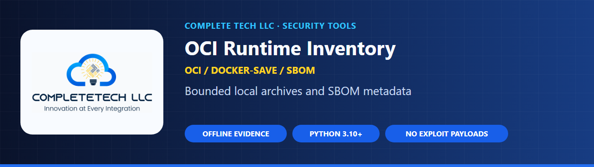
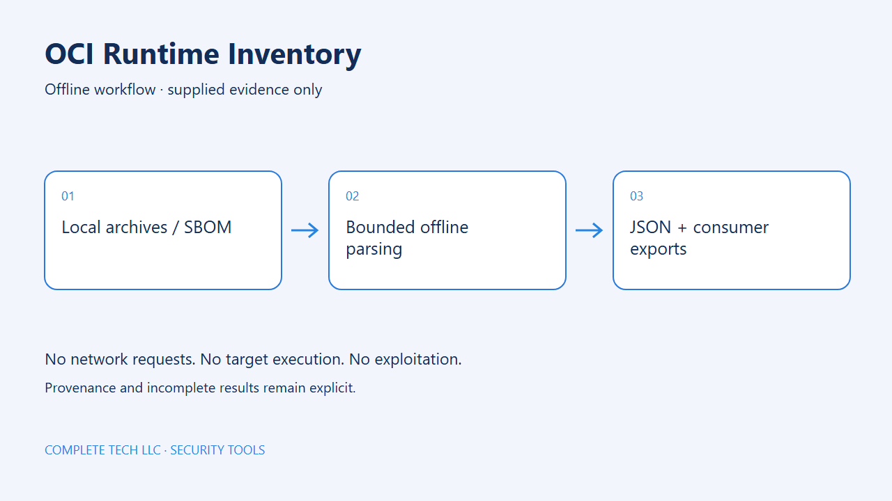

<p align="center">
  
</p>

<p align="center">
  <a href="https://github.com/CompleTetech-Security/oci-runtime-inventory/actions"></a>
  
  
  <a href="LICENSING.md"></a>
</p>

# oci-runtime-inventory

**Offline, bounded package inventory for local OCI-layout and Docker-save archives and supported SBOM JSON.**

oci-runtime-inventory is a standalone Python 3.10+ standard-library script. It
reads explicit local evidence and records which Sharp, Flowise,
flowise-components and Node.js package metadata it can observe, together with
the digests, coverage and limits behind each observation. It is optional
supporting infrastructure for
[node2shell-check #12](https://github.com/completetech-security/node2shell-check/issues/12);
no exploit checker requires it at runtime.

## Contents

- [Scope](#scope)
- [Requirements](#requirements)
- [Quick start](#quick-start)
- [Offline workflow](#offline-workflow)
- [Usage](#usage)
- [Interpreting the output](#interpreting-the-output)
- [Supported formats and limits](#supported-formats-and-limits)
- [Exit status and failure handling](#exit-status-and-failure-handling)
- [Limitations](#limitations)
- [Validation and provenance](#validation-and-provenance)
- [Project documents, license and brand](#project-documents-license-and-brand)

## Scope

**What it does.** It parses an uncompressed OCI image-layout or Docker-save TAR
and/or CycloneDX/SPDX JSON, applies image layers in memory, and reports selected
package metadata with exact digest evidence. It can also export that metadata in
the input formats of the standalone Node2Shell, Sharp and Flowise checkers.

**What it never does.** It never runs Docker, executes an image, binary or
package, extracts archive paths onto the host, follows archive links, opens a
network connection or guesses runtime versions from tags or names.

**What its results mean.** Output is package metadata, not an assessment:

- All local exploitability is `not_tested`; no vulnerability or safety verdict is
  produced.
- No observation is proof of absence, and installed package metadata does not
  attest deployed runtime use (see [Limitations](#limitations)).
- No advisory fix table is embedded and no feed is consulted.

**Authorization and handling.** Only read images and evidence you are authorized
to inspect. Real images, inventories and reports must stay outside version
control; the checked-in `examples/inventory.sbom.json` is synthetic.

## Requirements

- Python 3.10 or newer; no installed dependencies and no companion files. The
  Python entry point works when copied alone.
- Local evidence files: an uncompressed OCI-layout or Docker-save TAR and/or
  CycloneDX 1.4-1.6 or SPDX 2.2/2.3 JSON (see [Supported formats and limits](#supported-formats-and-limits)).
- For no-force output publication, a filesystem that supports hard links; it
  fails closed otherwise.

## Quick start

```sh
# Canonical inventory of an authorized image archive
python oci_runtime_inventory.py --archive authorized-image.tar --output image-inventory.json

# Canonical inventory of the synthetic example SBOM, printed to stdout
python oci_runtime_inventory.py --sbom examples/inventory.sbom.json

# Run the local-only test suite
python -m unittest -v
```

Consumer exports for the standalone checkers:

```sh
python oci_runtime_inventory.py --archive authorized-image.tar --consumer sharp --output sharp-input.json
python oci_runtime_inventory.py --archive authorized-image.tar --consumer node2shell --output node-input.json
python oci_runtime_inventory.py --sbom examples/inventory.sbom.json --consumer flowise --output flowise-input.json

# Keep the canonical inventory alongside a consumer export
python oci_runtime_inventory.py --sbom examples/inventory.sbom.json --consumer sharp --output sharp-input.json --receipt sharp-receipt.json
```

## Offline workflow

<picture>
  <source media="(prefers-color-scheme: dark)" srcset="docs/images/overview-dark.png">
  
</picture>

Supplied local evidence only. The tool does not contact targets or execute the
software being assessed.

## Usage

At least one of `--archive` or `--sbom` is required. Run
`python oci_runtime_inventory.py --help` for the authoritative option list.

| Option | Meaning |
| --- | --- |
| `--archive PATH` | Existing uncompressed OCI-layout or Docker-save TAR archive. |
| `--sbom PATH` | Existing CycloneDX 1.4-1.6 or SPDX 2.2/2.3 JSON. Repeatable, at most 100. |
| `--consumer {canonical,node2shell,sharp,flowise}` | Output format. Default `canonical`; the others emit offline consumer inventories whose provenance remains unverified. |
| `--max-expanded-mib N` | Global expanded-byte budget, 16-4096 MiB (default 512). |
| `--output PATH` | New JSON report path. Default is stdout. |
| `--receipt PATH` | Canonical receipt for a consumer export, linked by its exact SHA-256. Valid only with a non-canonical `--consumer`. |
| `--force` | Replace an existing report or receipt, never a protected input. |
| `--version` | Print the tool version. |

### Output protection

`--output` (and `--receipt`) refuse existing files unless `--force` is explicit,
and always protect inputs, aliases and the executable. No-force publication
requires hard-link support and fails closed otherwise.

### Consumer exports

`--consumer node2shell|sharp|flowise` emits the actual input contracts of those
standalone checkers. Unverified provenance and library selection are retained, so
metadata alone produces unknown assessments.

- Qualified, oversized or control-bearing versions are never normalized into
  patch claims.
- Incomplete images are excluded from consumer records. Absent supported records
  produce unknown placeholders, not empty evidence presented as a clean scan.
- Canonical output retains the full coverage and provenance record; consumer
  output intentionally carries only each checker's accepted fields.
- Preserve the process exit code as well as the output.
- Exports are bounded by the destination input contract: Sharp 1,000 records /
  4 MiB, Node2Shell 10,000 records / 4 MiB, Flowise 10,000 records / 16 MiB. An
  oversized merged export fails before publication; use canonical output or split
  the source inputs explicitly. No records are silently truncated.

### Receipts

Consumer schemas do not accept the canonical generation/tool envelope, so those
fields are never inserted into consumer records. Use `--receipt PATH` with a
consumer export to retain the canonical inventory alongside it.

- The receipt contains `consumer`, `export_sha256` (SHA-256 of the exact exported
  UTF-8 JSON bytes, including the final newline) and `inventory`. It contains no
  input/output path or hostname.
- CLI stdout is written as UTF-8 bytes without platform newline translation, so a
  redirected export has the same hash on Windows and POSIX.
- The two output paths must be distinct, and each uses the same protected
  no-clobber/explicit-force policy.
- The receipt is published first, and publication of the two files is not
  transactional. If interruption or output failure leaves only the receipt,
  compare its `export_sha256` with the consumer bytes actually received before
  associating them. Neither publication is retried after either begins.
- A receipt for incomplete input retains `complete=false`; the consumer keeps its
  existing unknown placeholder policy and exit code.

## Interpreting the output

### Identities and digests

Canonical JSON schema 1.0 records supported parsing coverage, limits and usage,
artifact identities, layer digests and logical file provenance.

- **OCI images:** the identity is the verified manifest digest, which binds the
  declared layer descriptors.
- **Docker-save images:** the identity is the config-byte digest. It identifies
  only the config bytes and does not bind the archive layers: `rootfs.diff_ids`
  are not validated, and identical configs with different supplied layers retain
  the same config digest. Use the separately recorded ordered layer digests when
  comparing observations.
- `identity_kind` distinguishes the two kinds of identity.
- Neither identity establishes publisher trust or that an archive can run.
- **SBOMs:** digests identify the SBOM artifact, not an image.
- Config Env/Cmd/hostnames and image tags are not reported.

### Generation time and content hash

Canonical reports retain `generated_at` (UTC inventory-generation time),
`tool.version` and `tool.executable_sha256` (SHA-256 of the standalone file's
bytes, including when invoked through a symlink). The code has no separate
advisory/rule table: the executable digest identifies its parser and export rules.

- Generation time is captured once per invocation and reused if an interruption
  produces a partial report. It is not an artifact build time,
  evidence-acquisition time, publisher attestation or deployed-state observation.
  No such times are inferred from file or archive modification timestamps.
- `content_sha256` hashes the canonical JSON projection with `generated_at` and
  `content_sha256` omitted, using sorted keys, ASCII escaping, two-space
  indentation and a final newline in UTF-8. This permits stable content
  comparisons across different generation times while retaining all tool,
  coverage and artifact evidence. Artifact, config, layer and SBOM digests are
  unaffected.
- For deterministic Python fixtures, `main(argv, clock=...)` accepts a callable
  returning an aware `datetime`; it is converted to UTC without altering content
  identities or confidence. The public CLI uses the current UTC clock.

### Layer model

The virtual filesystem applies layers in order.

- Whiteouts remove lower-layer entries; opaque whiteouts retain same-layer
  additions regardless of TAR ordering.
- Replaced or deleted manifests cannot survive as current package observations.
- Links and device entries are opaque replacement nodes, never followed or created.
- Metadata under a nondirectory ancestor, or a selected metadata path that is a
  link, device or directory, makes image coverage incomplete.
- Empty layers skip lower-snapshot traversal, and aggregate lower-snapshot path
  visits are limited to two million. Per-layer selected-file ancestor validation
  examines only new file observations; earlier verified state is not rescanned
  for empty layers.

### Package versions

- Exact versions come only from selected package manifests (Sharp, Flowise and
  flowise-components) or Node.js package-database records (dpkg/APK).
- Held dpkg Node packages retain installed-version metadata.
- Namespaced CycloneDX packages are not matched as unscoped Sharp, Flowise or
  Node names.
- CycloneDX subject component provenance uses `metadata/component` without an
  invented array index.
- No filename, tag or binary-string inference is performed.
- Every candidate `package.json` is captured and strictly parsed before its
  package name is known. Irrelevant manifests still consume the shared capture
  budget; malformed or excessive candidates make that image incomplete.

## Supported formats and limits

### Inputs

- **Outer archive:** uncompressed USTAR/V7 TAR containing OCI image-layout 1.0 or
  Docker-save manifest/config/layers. Regular GNU members work when they fit basic
  header fields. No host filesystem extraction is used. SHA-256 OCI
  manifest/config/layer descriptors and declared blob sizes are checked;
  descriptor URLs are never used.
- **Layers:** OCI plain-TAR or gzip layers; Docker-save plain-TAR layers.
  Extended PAX/GNU long-name/sparse records, zstd, foreign layers, unsupported
  digests, outer gzip and other archive formats are unresolved, not silently
  accepted as complete.
- **OCI descriptors:** must explicitly identify an OCI image manifest/index or
  Docker schema-2 manifest/list. OCI indexes require `schemaVersion` 2. An
  optional manifest `mediaType` must match its descriptor. Only OCI image-config
  or Docker image-config media types authorize filesystem interpretation; the
  config bytes remain opaque and digest-verified.
- **Incomplete artifact records:** manifests declaring `artifactType`, empty
  artifact configs, missing config media types, unknown descriptor/config types,
  OCI attestation manifests and unsupported layer media types are recorded as
  incomplete, with no package observations or consumer records. Verified manifest
  digests remain in canonical output, and supported image siblings retain their
  observations. Platform labels are not collected.
- **SBOMs:** JSON CycloneDX 1.4/1.5/1.6, including `metadata.component` and nested
  components; SPDX 2.2/2.3 package metadata. This reads selected metadata fields,
  not full SBOM conformance or deployment/relationship attestation.

### Limits

| Limit | Value |
| --- | --- |
| Expanded layer bytes | 512 MiB default; `--max-expanded-mib` accepts 16-4096 |
| Outer archive | 8 GiB |
| Compressed layer reads | 1 GiB |
| Archive and layer members | 100,000 |
| Layer reads | 200,000 shared calls (also bounds per-byte gzip header processing) |
| Path | 64 components / 512 characters |
| Images | 16 |
| Layers per image | 256 |
| Index descriptors | 64, with three nested indexes |
| Metadata file | 4 MiB each; 16 MiB aggregate captured |
| SBOM component entries | 10,000 visited (including irrelevant entries) |
| Selected component records | 10,000 per image |
| SBOM inputs | 100 |
| TAR tail padding | 1 MiB (outer archive and layers share the cap) |
| JSON | bounded depth and node count |

Limits and budgets are shared across images and are never reset for a sibling.
These deliberately conservative bounds can reject large valid images and SBOMs.

## Exit status and failure handling

| Exit | Meaning |
| --- | --- |
| `0` | Supported inspection completed. This does not mean a runtime is safe. |
| `2` | Coverage is incomplete (unsupported or malformed input, integrity mismatch or any limit, recorded with a symbolic reason), or an operational failure occurred (unavailable or invalid input, protected or unwritable output, invalid arguments). |
| `130` | Interrupted. |

- **Incomplete coverage.** `complete` is `false` and completed images are
  preserved. No components from a failed image are emitted.
- **Localized failures.** OCI image planning errors, malformed child OCI indexes
  and independent Docker-save entries become incomplete records while supported
  siblings retain their package observations and digest provenance, regardless of
  sibling order. A rejected child index retains its verified descriptor identity;
  a Docker entry retains its config digest only after the config bytes have been
  read, otherwise its identity is `unknown`. Rejected entries provide no consumer
  records, and overall status remains incomplete (exit 2). Corruption of the root
  layout/index or exhaustion of global planning limits may still prevent archive
  inspection.
- **Interruption.** Completed observations are preserved before output begins
  when possible. Once stdout or atomic file publication starts, it is never
  retried; inspect interrupted output before running again.
- **Stable evidence.** Ordinary regular-file and path checks assume stable
  evidence copies and are not a sandbox against concurrent filesystem mutation.

## Limitations

- Installed package metadata does not attest deployed runtime use, bundled or
  global native linkage, vendor patches or custom builds.
- Versions are reported as found; a reported version is not a verified deployed
  patch, and the tool makes no patch or fix claims.
- Metadata-only provenance is unverified, so consumer assessments are unknown.
- Exploitability is always `not_tested`, and absence of an observation is not
  proof of absence.
- Unsupported formats are marked unresolved rather than accepted as complete.

## Validation and provenance

Tests use synthetic archives only. They cover layer replacement and deletion,
whiteout ordering, links and devices, traversal, duplicate/sparse/extended
records, truncation, checksums and digests, expansion limits, metadata privacy,
standalone execution, output aliases and interruption. Real exported consumer
payloads were also accepted by the actual Node2Shell, Sharp and Flowise CLIs with
unknown assessments. Local checks and exact-commit hosted CI are separate
evidence, and GitHub Copilot reviews published changes before merge. Hosted CI
runs the tests and `--help` on Ubuntu, Windows and macOS with Python 3.10 and 3.14.

Format references reviewed 2026-10-25:
[OCI layout](https://github.com/opencontainers/image-spec/blob/main/image-layout.md),
[OCI layers/whiteouts](https://github.com/opencontainers/image-spec/blob/main/layer.md),
[CycloneDX schema](https://github.com/CycloneDX/specification/blob/master/schema/bom-1.6.schema.json),
[SPDX package metadata](https://spdx.github.io/spdx-spec/v2.3.1/package-information/).

No advisory fix table is embedded: this is supporting inventory, not an exploit
checker. Consumer schemas are pinned by the documented v1 contracts; no feed or
network dependency is introduced.

## Project documents, license and brand

- [AGENTS.md](AGENTS.md): repository instructions
- [CONTRIBUTING.md](CONTRIBUTING.md): contribution terms
- [SECURITY.md](SECURITY.md): security policy
- [LICENSE](LICENSE) (AGPL-3.0) and [LICENSING.md](LICENSING.md): dual licensing,
  AGPL-3.0 or a separate commercial license from CompleteTech LLC
- [BRAND_ASSETS.md](BRAND_ASSETS.md): brand policy. CompleteTech LLC names and
  logos, including the artwork in `docs/images`, are not covered by the code
  license.
